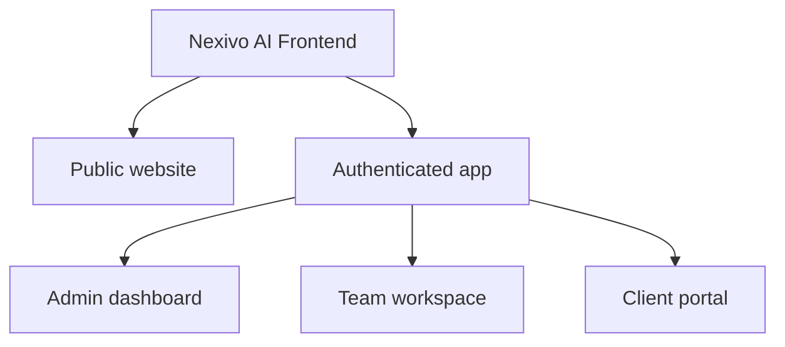
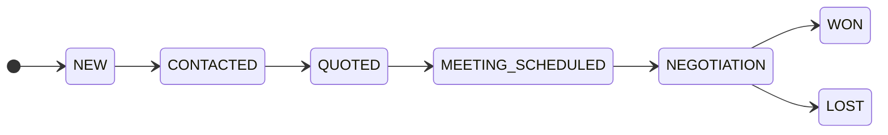
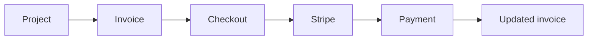
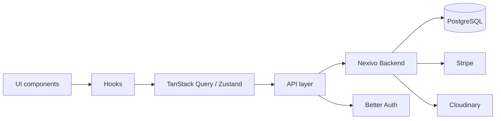

<div align="center">

<!-- Replace with your logo: place it at public/logo.png -->


# Nexivo AI

### The AI-powered workspace for modern agencies

Manage leads, clients, projects, proposals, invoices and payments — with AI built into every step of the workflow.

<br />

[](https://your-frontend-url.vercel.app)
[](https://github.com/Alaminahmedariyan/nexivo-ai-backend)


[**Highlights**](#-highlights) ·
[**Areas**](#-application-areas) ·
[**Architecture**](#-architecture) ·
[**Getting Started**](#-getting-started)

</div>

---

## 📑 Table of Contents

- [Overview](#-overview)
- [Screenshots](#-screenshots)
- [Highlights](#-highlights)
- [Tech Stack](#-tech-stack)
- [Application Areas](#-application-areas)
- [Architecture](#-architecture)
- [Project Structure](#-project-structure)
- [Getting Started](#-getting-started)
- [Environment Variables](#-environment-variables)
- [Security](#-security)
- [Related Repositories](#-related-repositories)
- [Author](#-author)
- [License](#-license)

---

## ✨ Overview

**Nexivo AI Frontend** is a modern, scalable **AI agency SaaS web application**. It gives agencies a polished interface to run their operations across **leads, clients, projects, proposals, invoices, payments, AI workflows, notifications and content management**, and works with the [Nexivo AI Backend](https://github.com/Alaminahmedariyan/nexivo-ai-backend) API.

| | |
|---|---|
| 🏠 **Public website** | Landing page, services, portfolio, testimonials, contact forms |
| 👑 **Admin dashboard** | Centralized control over the whole platform |
| 👨‍💻 **Team workspace** | Leads, clients, projects, proposals and AI workflows |
| 🤝 **Client portal** | Projects, progress, files, proposals, invoices and payments |
| 🤖 **AI workspace** | Conversations, proposal generation and usage tracking |
| 💳 **Billing** | Stripe-powered checkout for invoices |

---

## 🖼️ Screenshots

<!-- Add screenshots to /docs/screenshots and update the paths below -->

| Landing page | Admin dashboard |
|---|---|
|  |  |

| Leads pipeline | AI workspace |
|---|---|
|  |  |

---

## 🚀 Highlights

| | | |
|---|---|---|
| ⚡ **Next.js 16** App Router | ⚛️ **React 19** | 🔷 **TypeScript** |
| 🎨 **Tailwind CSS 4** | 🧩 **shadcn/ui + Radix UI** | 🔄 **TanStack Query** server state |
| 📊 **TanStack Table** data tables | 🗂️ **Zustand** client state | 📝 **React Hook Form + Zod** |
| 💳 **Stripe** payments | 🎞️ **Framer Motion** animations | 🌙 **Light / dark / system** theme |
| 🔔 **Sonner** toasts | 🔐 **Better Auth** integration | ☎️ **International phone** input |

---

## 🧰 Tech Stack

| Technology | Usage |
|---|---|
| **Next.js 16** · **React 19** · **TypeScript 5** | Framework and language |
| **Tailwind CSS 4** · **shadcn/ui** · **Radix UI** | Styling and accessible UI primitives |
| **TanStack Query** | Server-state management |
| **TanStack Table** | Advanced data tables |
| **Zustand** | Client-state management |
| **React Hook Form** · **Zod** | Forms and validation |
| **Stripe** (`@stripe/stripe-js`, `@stripe/react-stripe-js`) | Payments |
| **Framer Motion** | Animations |
| **next-themes** | Theme management |
| **Sonner** | Toast notifications |
| **Lucide React** | Icons |
| **date-fns** · **libphonenumber-js** | Date and phone utilities |

---

## 🧭 Application Areas



<details open>
<summary><b>🏠 Public website</b></summary>

Agency landing page · services and packages · portfolio · technologies · testimonials · contact / quote forms · newsletter subscription · public AI entry points

</details>

<details>
<summary><b>🔐 Authentication</b></summary>

Powered by **Better Auth** with five roles: `SUPER_ADMIN`, `ADMIN`, `TEAM_MEMBER`, `CLIENT`, `USER`. Flows: `/login`, `/register`, `/forgot-password`, `/reset-password`. Authenticated areas are protected by role and permissions.

</details>

<details>
<summary><b>👑 Admin dashboard</b></summary>

Users · Leads · Clients · Projects · Services · Packages · Portfolios · Technologies · Testimonials · Site Settings · Invoices · Payments · AI · Notifications · Activity Logs · API Keys

</details>

<details>
<summary><b>👨‍💻 Team workspace</b></summary>

Assigned leads · clients · projects · milestones · timelines · project files · proposals · AI workflows · notifications

</details>

<details>
<summary><b>🤝 Client portal</b></summary>

Projects and progress · milestones · timelines · files · proposals · invoices · payments · notifications

</details>

<details>
<summary><b>📩 Lead management</b></summary>



Search, filtering, sorting and pagination · lead details · assignment · status management · conversion workflow · meeting scheduling

</details>

<details>
<summary><b>📁 Project management</b></summary>

Each project is organized into **Overview · Members · Milestones · Timeline · Files · Proposals · Invoices**, with progress tracking and team collaboration.

</details>

<details>
<summary><b>🤖 AI workspace</b></summary>

- **Conversations** — conversation list, conversation view and message composer
- **Proposals** — generate, review, edit, change status and accept
- **Usage** — AI usage, token usage, execution history and workflow executions

</details>

<details>
<summary><b>💳 Billing & payments</b></summary>



</details>

<details>
<summary><b>🔔 Notification center</b></summary>

All · Unread · Mark as read · Mark all as read — covering leads, projects, milestones, clients, proposals and AI activity.

</details>

---

## 🏗️ Architecture



Presentation, state and server communication stay separate:

- **Forms:** React Hook Form → Zod validation → API request → backend validation (the backend remains the source of truth)
- **Data screens:** API → TanStack Query → table / components → user action → mutation → query invalidation

---

## 📂 Project Structure

```
nexivo-ai-frontend/
├── app/
│   ├── (public)/        # Public website
│   ├── (auth)/          # Login, register, password flows
│   ├── dashboard/
│   ├── leads/
│   ├── clients/
│   ├── projects/
│   ├── proposals/
│   ├── invoices/
│   ├── payments/
│   ├── ai/
│   ├── notifications/
│   └── settings/
├── components/
│   ├── ui/              # shadcn/ui primitives
│   ├── forms/
│   ├── tables/
│   ├── dashboard/
│   ├── layout/
│   └── shared/
├── hooks/
├── lib/
│   ├── api/
│   ├── auth/
│   ├── query/
│   ├── validations/
│   └── utils/
├── store/               # Zustand stores
├── types/
├── public/
├── next.config.ts
├── package.json
├── tsconfig.json
└── postcss.config.mjs
```

---

## 🏁 Getting Started

**Prerequisites:** Node.js 18+, pnpm (or npm / yarn), and a running [Nexivo AI Backend](https://github.com/Alaminahmedariyan/nexivo-ai-backend).

```bash
# 1. Clone
git clone <repository-url>
cd nexivo-ai-frontend

# 2. Install
pnpm install

# 3. Configure environment
#    create .env.local (see below)

# 4. Start
pnpm dev
```

Open [http://localhost:3000](http://localhost:3000).

| Command | Description |
|---|---|
| `pnpm dev` | Start the development server |
| `pnpm build` | Create a production build |
| `pnpm start` | Start the production server |
| `pnpm lint` | Run ESLint |

---

## 🔐 Environment Variables

Create a `.env.local` file in the project root.

```env
NEXT_PUBLIC_API_URL=http://localhost:5000/api/v1
NEXT_PUBLIC_AUTH_URL=http://localhost:5000/api/auth
NEXT_PUBLIC_APP_URL=http://localhost:3000

NEXT_PUBLIC_STRIPE_PUBLISHABLE_KEY=
```

> ⚠️ Only public values use the `NEXT_PUBLIC_` prefix. Never expose backend secrets, Stripe secret keys, database credentials or private API keys in the frontend.

---

## 🛡️ Security

- Protected routes with **role-aware UI**
- **Better Auth** integration, with authorization enforced by the backend
- **Zod** client-side validation
- Stripe **publishable key** only — no secrets in browser code
- Careful environment variable handling

---

## 🔗 Related Repositories

| Repository | Description |
|---|---|
| **nexivo-ai-frontend** (this repo) | Next.js frontend |
| [**nexivo-ai-backend**](https://github.com/Alaminahmedariyan/nexivo-ai-backend) | Express + Prisma API for authentication, leads, clients, projects, AI, proposals, invoices, payments and more |

---

## 👨‍💻 Author

**Alamin Ahmed** — Full Stack Developer

[](https://github.com/Alaminahmedariyan)
[](https://www.linkedin.com/in/alamin-ahmed-536463382)

---

## 📄 License

Distributed under the **ISC License**.

<div align="center">

<br />

Built with ❤️ using Next.js, React & Tailwind CSS

</div>